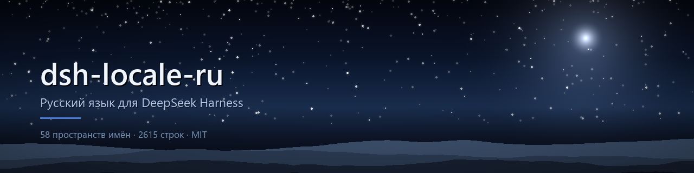

[Русский](README.md) | **English**



# dsh-locale-ru

[](LICENSE)
[](#requirements)
[](#requirements)
[](#coverage)
[](#coverage)
[](#security)
[](tools/audit-bundle.js)

Russian localisation for the DeepSeek Harness web interface: **58 of 58
namespaces, 2615 strings**.

This is not a patch. DeepSeek Harness ships a pluggable locale service, and this
package simply adds the `ru` language that the distribution does not include. It
downloads nothing, needs no administrator rights, never touches the application
installation, and uninstalls with one command.

> The main documentation is in Russian — [README.md](README.md). This page is a
> summary for English-speaking readers.

## Install

```powershell
# close DeepSeek Harness completely first: tray icon -> "Quit DeepSeek Harness"
powershell -ExecutionPolicy Bypass -File install-standalone.ps1
```

`install-standalone.ps1` (from the latest release) is a single self-contained
file — the whole package is embedded, nothing to extract alongside it.

Requirements: Windows, DeepSeek Harness desktop **launched at least once**,
version `0.2.0-rc.2`, a regular (non-administrator) account. Node, pnpm and an
internet connection are **not** required.

Uninstall:

```powershell
powershell -ExecutionPolicy Bypass -File uninstall.ps1
```

## Security

The package is data plus one small browser bundle. That claim is checked
mechanically by [`tools/audit-bundle.js`](tools/audit-bundle.js), not merely
asserted:

| Capability | Status |
|---|---|
| Network (`fetch`, `XMLHttpRequest`, `WebSocket`, `EventSource`) | absent |
| Code execution from strings (`eval`, `new Function`) | absent |
| File system, processes, environment variables | absent |
| `localStorage`, cookies, `indexedDB` | absent |
| Electron, IPC, system `require` | absent |
| HTML injection (`innerHTML`, `createElement('script')`) | absent |
| Dependencies, `postinstall`, any `scripts` | absent |
| Telemetry, callbacks home | absent |

The host half is **367 bytes** of an empty function with no imports. The browser
half makes exactly three calls, all on the public locale service:
`ctx.locale.addLanguage(...)`, `ctx.locale.register(ns, 'ru', dict)` and
`ctx.effect(...)` to own them.

The installer never requests elevation, copies only a fixed six-file list into
the user's profile, and leaves the DeepSeek Harness installation untouched.
Nothing is fetched at install time.

Verify it yourself:

```powershell
node tools/audit-bundle.js             # forbidden capabilities, leaks, markup
node tools/build.js                    # rebuild from sources
git diff --exit-code lib/client.js     # does the published artifact match?
```

Report vulnerabilities privately — see [SECURITY.md](SECURITY.md).

## Coverage

58 of 58 namespaces, 2615 of 2615 strings — the entire user-facing copy served
by the client plugins.

| Namespace | Keys | Namespace | Keys |
|---|---:|---|---:|
| `conversation` | 369 | `settings.models` | 113 |
| `trajectory` | 192 | `workspace` | 112 |
| `pluginManager` | 189 | `voice-input` | 101 |
| `schedule.manager` | 187 | `settings.account` | 93 |
| `chat` | 186 | `schedule.catalog` | 70 |

130 values are deliberately left in Latin: format strings and separators
(`", "`, `"{from}–{to}"`, `"UTC"`), bare placeholders, product and application
names (VS Code, GitHub Desktop, Android Studio, DeepSeek Harness,
Hugging Face) and protocol names (Anthropic Messages, OpenAI Responses).

Terminology is documented in [docs/glossary.md](docs/glossary.md) (Russian).

## How it works

1. `package.json` declares `dsh.bundle.patch` (a profile layer) and `dsh.client`
   (`platform: web`), so the host includes the package both in the server tree
   and in the browser boot graph.
2. `cordis.patch.yml` adds one loader row.
3. `lib/index.js` is an empty host half that exists only for that row.
4. `lib/client.js` registers the language and one dictionary per namespace.
5. Missing keys fall back to English, so partial translations degrade
   gracefully and the UI never shows empty strings.

See [docs/how-it-works.md](docs/how-it-works.md) (Russian) for the details.

> **A restart is mandatory.** The host reads the browser bundle once at
> activation; only the HMR `rebuilt()` hook refreshes it, and this profile runs
> HMR with `root: []`, so plugin sources are not watched. Reloading the page
> (F5) does not help, and closing the window does not quit the app.

## Integrity

The build is **reproducible**: identical sources produce byte-identical output,
which is what makes the published artifact verifiable against the open sources.

| File | Size | SHA-256 |
|---|---|---|
| `lib/client.js` | 215 257 B | `ab7b5414ad8d94f1a6ab212fca0fae1b85972736c7c6bf8022215a1243b80eb7` |
| `lib/index.js` | 367 B | `0e6468313e04779e71d0a7defa4e370b14603ce9bd0631fdd7004d286e5a5c9c` |

## Limitations

- Built and tested against `0.2.0-rc.2`. On another version some keys may fall
  back to English — degraded, not broken.
- The locale service distinguishes only `.one`/`.other`, while Russian needs
  three plural categories. `.other` uses the genitive plural, so counts 2–4 read
  slightly off. A framework constraint, not a translation defect.
- Web interface only: the console `tui` profile has no locale service.
- Windows only, because the installers are PowerShell.

## License

MIT — see [LICENSE](LICENSE).

**Unofficial.** Not affiliated with DeepSeek. The DeepSeek Harness interface and
its original English strings belong to their authors; the `@deepseek-ai/dsh-*`
packages are published under the MIT licence, which is what makes this
translation and its distribution permissible. The translated text is a
derivative work.
